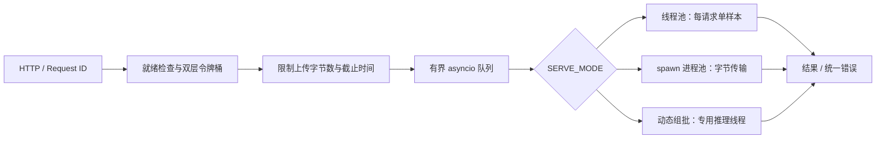

# 设计说明

## 请求与执行边界

ASGI 事件循环做准入、入队、Future 等待和轻量响应；Pillow 解码、预处理、PyTorch 推理均在工作线程或子进程中执行。`EXP_INLINE_PREPROCESS=1` 才故意让预处理占用事件循环。模型统一实现 `preprocess / infer_batch / postprocess`；服务不依赖具体张量格式。

线程池共享只读 `eval()` 模型；所有调用独立进入 `torch.inference_mode()`。进程池显式使用 spawn，每个 initializer 独立加载模型、设置线程数、预热；屏障确保**所有**子进程 ready 后才对外服务。进程间只传图片字节、参数和小型结果，不传大张量。代价是每个进程各有模型及线程池，多进程 GPU 模式通常浪费显存。

## 排队、批处理和截止时间

三种模式都使用同一个有界 asyncio 队列，执行器前有固定数量消费者，避免 Executor 内部无界任务队列成为隐藏积压。容量表示尚未被消费者取走的请求数，不含当前推理批次和正在上传的请求。线程/进程模式各有 N 个单请求消费者；动态批模式只有一个消费者、一个推理线程。

批处理取第一条后等待至 `MAX_BATCH_SIZE` 或 `MAX_WAIT_MS`，还会取批内最早截止时间作为等待上限。`MAX_WAIT_MS=0` 表示立即单条发车。所有截止时间从 HTTP 请求进入服务时计算，客户端给出的 `X-Timeout-Ms` 只能缩短默认预算。请求体上传也受预算约束；工作线程解码前和正式推理前再次检查截止时间。

取消/过期的 Future 在调度时跳过，队列条目稍后被消费者清除，不继续调用模型。已经进入底层推理的任务无法被 Python Future 安全抢占；超时后允许其完成，但不回填已结束的 Future。重试会增加负载，因此客户端总预算、最大次数和退避必不可少。

每个图片单独解码：损坏文件只返回该样本 400。批推理 CUDA OOM 二分后重试，单样本仍 OOM 返回 500；其他推理异常逐样本各重试一次，坏样本不会拖累其余样本。响应 `batch_size` 是该样本最终成功执行的实际子批大小。

## 文件与错误契约

仅接受真实 JPEG/PNG 内容；不信任扩展名或 MIME。整个 multipart 请求体最多 `MAX_UPLOAD_BYTES + 64 KiB`，图片自身最多 `MAX_UPLOAD_BYTES`（默认 5 MiB），像素数默认最多 2000 万，防止小压缩文件解码产生过量内存。无 Content-Length 的 chunked 上传同样受限制。

错误形状统一为 `{code,message,request_id}`：400 输入、413 大小、429 频率、503 未就绪/队列满/停机、504 截止时间、500 推理/内部错误。429/503 附 `Retry-After: 1`。请求 ID 限制长度和字符，避免日志/响应头注入；缺省自动生成。

## 线程数与资源

`TORCH_THREADS=auto` 取 CPU affinity、可读取的 cgroup v2 cpu.max / v1 quota 的最小约束，按进程数量平分并向下取整，最低 1。分数核可能仍被节流，须看实际 CPU throttling。容器能看到的父级配额可能受 mount namespace 限制，测量时同时记录宿主约束。线程模式只计算一个模型进程，多个推理线程仍可能产生 CPU 过度订阅，需扫描 `THREADPOOL_SIZE × TORCH_THREADS`。

`TORCH_THREADS=0` 不调用 set_num_threads，用于实验 A。线程数应在模型初始化时确定，不能在并发请求中反复修改 PyTorch 全局配置。

## 限流和日志

全局桶和每个 key/IP 的桶都允许才扣令牌；配置 QPS=0 分别关闭该层。key 桶按 LRU/TTL 淘汰，内存有上限；高基数 key 可让局部限流失效，因此全局桶仍有必要。X-API-Key 不做鉴权，客户端可以变更它；反向代理下 IP 默认是直连对端。多实例限流应迁移至网关或 Redis，本项目未引入 Redis。

每个请求一行 JSON 访问日志，QueueHandler 将 stdout 写入转交后台线程。日志队列有界，过载时丢弃日志并累计 handler.dropped（不让日志反压推理）。实验 B 额外同步写文件并 fsync，刻意制造 IO 等待。强制 SIGKILL 可能丢日志；正常关闭会排空队列。

## 指标语义

| 指标 | 口径 |
|---|---|
| request_seconds | HTTP 全流程，包含上传/排队/推理；直方图标签为路由模板 |
| queue_ms | 入队至该图片开始预处理；后面样本可能包含前面样本预处理时间 |
| preprocess_ms | 该图片预处理耗时；实验 D 含循环内预处理 |
| inference_ms | 该请求所属批次的推理和传输耗时，失败重试时含之前失败尝试 |
| execution_seconds | 每个成功请求观察一次其 inference_ms，不用于算 GPU 占用率 |
| batch_size 直方图 | 调度器每次派出的请求数，含后续解码失败或截止时间内过期的样本 |
| 响应 batch_size | 最终成功执行的真实子批大小；OOM 拆批后可能变小 |
| queue_depth | 尚未被消费者取走的队列条目数量，可能含尚待清理的取消条目 |
| inflight | 当前 HTTP 请求数量 |
| CPU | 父子进程 CPU 百分比总和，100% 表示一核 |
| memory | 父子进程 RSS 总和，共享页可能重复计算，不能当作 PSS |
| GPU | nvidia-smi 能按 PID 归属时采样；不可用时 available=0，不能把零解释为无开销 |

Prometheus Histogram 的 P99 是桶估计；报告的 P99 由逐请求 CSV 分位数计算。总延迟包含其他开销，各阶段不能简单相加推导端到端。模型基准只计 infer_batch（含 stack、设备传输、softmax），明确不包含图片解码。

## 启动与停机

推荐 `python -m app`：自定义 Uvicorn Server 在 SIGTERM/SIGINT/SIGBREAK 回调立即 `begin_shutdown()`，`readyz` 降为 503，拒绝新预测；随后 Uvicorn 等待已在途 HTTP，lifespan 排空队列。不能用普通 `uvicorn app.main:app` 声称具有相同的“信号到达立即摘除 readiness”语义。

`SHUTDOWN_TIMEOUT_S` 分别限制 Uvicorn HTTP 等待和服务队列排空；总等待可能接近两倍。超时后剩余请求返回 503（连接被上游/服务器取消时客户端可能收到连接终止）；Executor `shutdown(wait=False)` 不会强杀正在执行的本地线程或进程。Python 3.11 退出仍可能等待原生计算结束，Docker `stop_grace_period=40s` 提供最终强制结束边界。严苛 SLA 应引入受监管的独立推理工作进程。

## 参考

- [Torchvision ResNet18](https://docs.pytorch.org/vision/stable/models/generated/torchvision.models.resnet18.html)：预训练权重、标签和官方 transforms。
- [Python 3.11 Executors](https://docs.python.org/3.11/library/concurrent.futures.html)：spawn 与 shutdown 的行为边界。
- [FastAPI lifespan](https://fastapi.tiangolo.com/advanced/events/)：模型启动/关闭管理。
