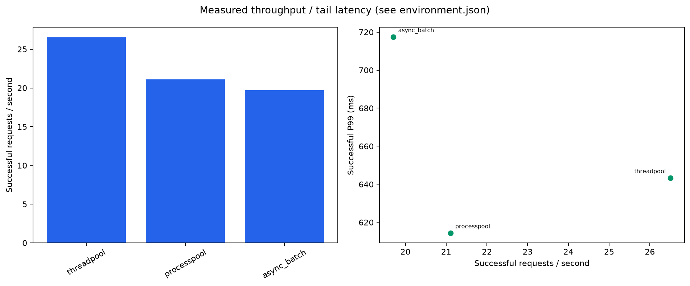
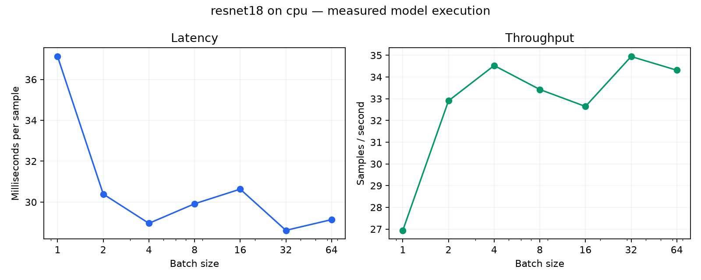

# 压测报告（真实 CPU 冒烟）

本报告由 `python -m bench.report` 从 CSV 自动生成。数据用于证明实现与测量链路可运行，
不能支持长期稳定性、生产容量或优化百分比结论。完整矩阵和 30 分钟实验尚待运行。

## 测试环境与边界

- 时间：2026-10-29T13:36:01.409006+00:00（UTC）；OS：Windows-10-10.0.26300-SP0；Python 3.11.16。
- 逻辑 CPU：16；物理内存：15.19 GiB。
- PyTorch 2.15.0+cpu / torchvision 0.29.2+cpu；FastAPI 0.162.0 / Locust 2.47.0。
- HTTP 代码版本：`1b1528b7c1d0688128e98d90c8c0f5b411c5e3fa`；服务核 0,1,2,3，客户端核 4,5；TORCH_THREADS=2。
- 输入：`reports/sample.png`。本次合成图不能用于准确率评估。机器运行桌面应用，CPU affinity 不代表物理核独占，也未固定频率。
- HTTP 每模式预热 3 秒、目标测量 10 秒，并发 4；限流关闭，批上限 4。QPS 分母使用实际窗口（含排空）。
- 模型基准每批预热 1 次、测量 3 次；未隔离 CPU，不能直接与 HTTP 模式对照。
- 本报告仅验证 CPU 运行；CUDA 运行时、GPU 推理和设备利用率须另行验证。
- [HTTP 完整环境](../reports/verified/cpu-http-smoke/environment.json)；[模型完整环境](../reports/verified/cpu-model/environment.json)。

## 三模式 HTTP 冒烟

| 模式 | 请求数 | 实际窗口 s | 成功 QPS | P50 ms | P95 ms | P99 ms | 失败率 | 峰值 RSS MiB |
|---|---:|---:|---:|---:|---:|---:|---:|---:|
| threadpool | 258 | 9.73 | 26.51 | 136.30 | 209.02 | 643.26 | 0.00% | 445.98 |
| processpool | 204 | 9.67 | 21.10 | 182.80 | 252.08 | 614.34 | 0.00% | 831.65 |
| async_batch | 192 | 9.74 | 19.70 | 188.20 | 266.13 | 717.40 | 0.00% | 396.47 |

共 654 次测量请求。本次最高成功吞吐为 **threadpool**；动态批处理没有在这组低并发 CPU 冒烟中胜出。不能据此给三种模式做通用排名。
进程池的模型副本增加 RSS；短时 P99 受冷路径、调度和样本数量影响，需长时间、多次复测。

[汇总 CSV](../reports/verified/cpu-http-smoke/summary.csv)；每模式目录保留 requests.csv、resources.csv、health.csv、Locust CSV 与实际时间窗口。

## 模型基准

只计 infer_batch（stack、设备传输、模型和 softmax），不含解码；均值不是 P99。

| 批大小 | 单批 ms | 单样本 ms | samples/s |
|---:|---:|---:|---:|
| 1 | 37.12 | 37.12 | 26.94 |
| 2 | 60.78 | 30.39 | 32.90 |
| 4 | 115.85 | 28.96 | 34.53 |
| 8 | 239.34 | 29.92 | 33.43 |
| 16 | 490.13 | 30.63 | 32.64 |
| 32 | 915.77 | 28.62 | 34.94 |
| 64 | 1865.12 | 29.14 | 34.31 |

批大小增大没有带来单调吞吐提升。这里只能观察到当前配置下的固定开销与批量计算取舍，不能证明瓶颈原因。

[逐次迭代数据](../reports/verified/cpu-model/raw.csv)。

## 算子分布

- batch 1：最高 CPU self-time 算子 `aten::mkldnn_convolution`，占 79.07%；[Top 15](../reports/verified/cpu-profile/batch-1-cpu.csv)，[Chrome trace](../reports/verified/cpu-profile/batch-1.json)。
- batch 16：最高 CPU self-time 算子 `aten::mkldnn_convolution`，占 82.98%；[Top 15](../reports/verified/cpu-profile/batch-16-cpu.csv)，[Chrome trace](../reports/verified/cpu-profile/batch-16.json)。

算子 self-time 占比用于定位，不等同于端到端耗时占比。采样本身存在开销。

## 尚待验证

- 三模式 × 并发 1/8/32/64/128 的完整矩阵和重复运行。
- 批大小 × 等待窗口、过载四组合、A/B/C/D 瓶颈前后对照。
- 30 分钟稳定性；当前短测不能宣称内存和错误率长期稳定。
- Docker 镜像/监控栈、JMeter 交叉验证、Linux py-spy/pidstat/iostat 证据。
- 真实 GPU 推理及 OOM；离线模拟仅验证拆批控制流。

复现实验命令见 [压测指南](bench-guide.md)。每个结论应同时报告成功 QPS、成功 P99、失败率、CPU/RSS 以及原始数据路径，保留不符合预期的结果。
